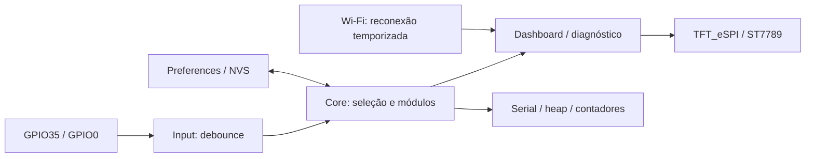

# TTGO Control Center

Fundação (Fase 1) para **ESP32 clássico + ST7789**, Arduino e PlatformIO. Não usar em T-Display S3.

## Estado

Implementados: menu de dois módulos, dashboard de uptime/heap/Wi-Fi, diagnóstico RGB e botões, debounce sem delay, reconexão Wi-Fi temporizada e seleção persistente em NVS. Sem framebuffer, alocação de sprites ou espera pela conexão no loop.

A revisão física **V1.1 ainda precisa ser confirmada na placa**. O perfil usa a pinagem clássica publicada pela LILYGO (tabela identificada como V18) e o Setup25 do TFT_eSPI. Compilar não confirma revisão, circuito ou funcionamento físico.

A unidade consultada na COM3 tem ESP32 clássico e **16 MB de flash**, enquanto o perfil padrão usa 4 MB. Veja [resultados e pendências](docs/phase1-results.md); o projeto mantém partições conservadoras nos primeiros 4 MB.

## Instalação

1. Abrir esta pasta no VS Code com PlatformIO.
2. Opcional: copiar `include/secrets.example.h` para `include/secrets.h` e preencher SSID/senha. Esse arquivo é ignorado pelo Git. Sem credenciais, o rádio fica desligado.
3. Executar `pio run`.
4. Conectar a placa por USB, verificar a porta com `pio device list`, executar `pio run -t upload --upload-port COMx`.
5. Executar `pio device monitor --port COMx --baud 115200`.

Binário: `.pio/build/ttgo-t-display/firmware.bin`. É a imagem da aplicação; usar PlatformIO para gravar também bootloader e tabela de partições nas posições corretas.

Para gerar o pacote sem credenciais: `powershell -ExecutionPolicy Bypass -File scripts/package.ps1`. O ZIP em `dist/ttgo-control-center-phase1.zip` inclui o binário quando disponível.

Se o ambiente não permitir escrever no cache global, definir `$env:PLATFORMIO_CORE_DIR = Join-Path (Get-Location) '.pio-core'` antes dos comandos PlatformIO. O cache local também é ignorado pelo Git.

GPIO35 avança no menu. GPIO0 abre/volta. Em Teste de hardware, os contadores permitem conferir os dois botões; GPIO0 retorna ao menu. A seleção é salva ao abrir um módulo e restaurada no boot. Não manter GPIO0 pressionado ao reiniciar, pois seleciona o bootloader.

## Hardware e versões

| Sinal | GPIO |
| --- | --- |
| MOSI / SCLK | 19 / 18 |
| CS / DC / reset | 5 / 16 / 23 |
| Backlight, ativo HIGH | 4 |
| Botões, ativos LOW | 35 / 0 |
| I²C opcional | 21 / 22 |
| ADC bateria / habilitação | 34 / 14 (não usados nesta fase) |

Painel 135 × 240 nativo, rotação 1 para 240 × 135, CGRAM_OFFSET, SPI 40 MHz. GPIO35 não tem pull-up interno: depende do resistor externo da placa. Sem PSRAM presumida. Dependências fixadas: Espressif32 6.9.0 e TFT_eSPI 2.5.43; o framework Arduino vem do pacote da plataforma.

Referências primárias:

- [LILYGO, firmware e esquemas da T-Display clássica](https://github.com/Xinyuan-LilyGO/TTGO-T-Display)
- [TFT_eSPI, configuração Setup25](https://github.com/Bodmer/TFT_eSPI/blob/master/User_Setups/Setup25_TTGO_T_Display.h)
- [PlatformIO, ESP32](https://docs.platformio.org/en/latest/platforms/espressif32.html)

## Arquitetura

`include/core/Module.h` define nome, habilitação e callback de renderização. `src/network` gerencia a conexão; `include/input` contém a lógica testável de debounce. Nesta fundação, composição, renderização e módulos pequenos ficam em `src/main.cpp`; serão extraídos ao crescer. Pelo menos um módulo deve permanecer habilitado. NVS grava apenas ao entrar, não a cada frame.

Renderização completa a cada segundo nas telas; pode apresentar flicker e será refinada na Fase 2. TFT e NVS são operações síncronas curtas: o loop não é uma garantia de tempo real. Não há HTTP, MQTT, NTP, OTA, backend ou módulos financeiros nesta fase.

## Validação

Seguir [checklist de bancada](docs/validation.md). O teste C++ em `tests/button_test.cpp` cobre bounce, pressão mantida, liberação, partida com botão pressionado e rollover de millis. Executar com um compilador C++ de host: `g++ -std=c++11 -Iinclude tests/button_test.cpp -o button_test` e `./button_test`.

Alternativa validada neste ambiente Windows: `scripts/test-button-wasm.ps1 -Clang <caminho-clang.exe> -Node <caminho-node.exe>`, com LLVM que inclua `wasm-ld`. Compila a mesma classe C++ para WebAssembly e executa os casos no Node; não testa GPIOs físicos.

Próximo passo após aprovação na bancada: Fase 2, separar display e módulos, atualizar regiões da tela e ampliar navegação. APIs e credenciais externas serão introduzidas nas fases correspondentes.
