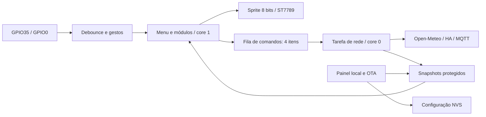

# TTGO Smart Hub

Projeto independente para LILYGO TTGO T-Display **clássica**, ESP32 + ST7789, tela 240 × 135 e dois botões. Versão atual 1.0.1, Arduino/PlatformIO. A T-Display S3 tem hardware diferente e não é suportada por este perfil.

## Funcionalidades

| Módulo | Comportamento |
| --- | --- |
| Dashboard | Relógio NTP, data, IP, RSSI, heap e quantidade de alertas |
| Clima | HTTPS Open-Meteo: temperatura atual, condição, vento e mínima/máxima do dia; atualização a cada 10 minutos |
| Wi-Fi Analyzer | Busca assíncrona 2,4 GHz, 24 redes mais fortes, canal, RSSI e indicação de proteção |
| MQTT | Assinatura de eventos, último payload, contador e telemetria a cada 30 segundos; TLS opcional |
| Alertas | Histórico circular de oito mensagens, níveis informação/aviso/erro, entrada MQTT ou HTTP autenticada |
| Home Assistant | Estado de uma entidade a cada 30 segundos e toggle confirmado de light, switch ou input_boolean |
| Configuração | AP protegido, painel local autenticado, ajustes em NVS, módulos habilitáveis e OTA autenticada |

Clima, MQTT e Home Assistant precisam das suas configurações e serviços disponíveis. O firmware contém implementações reais; build e testes de lógica não substituem a validação dessas integrações na sua rede.

## Instalar

1. Abra **esta pasta**, que contém `platformio.ini`, no VS Code + PlatformIO.
2. Compile: `pio run`.
3. Feche o monitor serial antes de gravar. Execute `pio run -t upload --upload-port COM3`, ajustando a porta se necessário.
4. Abra `pio device monitor --port COM3 --baud 115200`.

O binário da aplicação fica em `.pio/build/ttgo-smart-hub/firmware.bin`. Use PlatformIO no primeiro upload para gravar bootloader e partições corretamente. Firmware e configuração do Control Center pertencem a outro projeto; a gravação deste projeto substitui a aplicação da placa. Não usamos as chaves NVS do Control Center: namespace separado `smart-hub`.

Na primeira inicialização, o AP `TTGO-Hub-xxxx` é aberto. A senha aleatória individual aparece no serial. Na tela, segure GPIO35 por 700 ms para abrir Configuração e consultar a senha. Conecte ao AP, abra **http://192.168.4.1**, use usuário **admin** e essa senha. Salve sua rede Wi-Fi; a placa reinicia.

Para alterar configurações depois, abra Configuração e toque GPIO0 para ativar o painel/AP. O mesmo botão fecha o painel quando ele está ativo. Com Wi-Fi configurado, o painel fecha automaticamente após 10 minutos; sem configuração inicial, permanece aberto para provisionamento. Com o painel ativo, também pode acessar o IP da placa na rede doméstica. Os campos de senha/token são vazios e preservam o valor existente; marcar “Limpar senha Wi-Fi” permite rede aberta.

## Botões

| Contexto | GPIO35 | GPIO0 |
| --- | --- | --- |
| Menu | Próximo módulo | Abrir módulo |
| Clima | — | Atualizar |
| Wi-Fi Analyzer | Próxima página | Iniciar busca |
| Alertas | Próximo alerta | — |
| Home Assistant | — | Abrir confirmação; segundo toque envia toggle |
| Configuração | — | Abrir/fechar painel |

Segure GPIO0 por 700 ms para voltar ao menu em qualquer módulo. Segure GPIO35 para abrir Configuração. Não mantenha GPIO0 pressionado durante reset: ele é o pino de boot. A busca Wi-Fi exige fechar o painel/AP para evitar interromper clientes de configuração.

## Hardware e arquitetura

ST7789: MOSI19, SCLK18, CS5, DC16, RESET23, backlight4 ativo HIGH. Botões GPIO35 e GPIO0 ativos LOW. GPIO35 usa pull-up externo da placa. Rotação1, CGRAM_OFFSET e SPI40MHz. Sprite de 8 bits: 32.400 bytes, sem exigir PSRAM.

O hardware consultado anteriormente na COM3 tem ESP32-D0WDQ6-V3 e 16 MB de flash. O perfil mantém partições nos primeiros **4 MB** para compatibilidade. A revisão física V1.1 e a pinagem desta unidade ainda precisam ser conferidas; a identificação do chip não identifica a PCB.



`src/core` cuida de configuração; `src/network` do painel; `src/services` das consultas e estado compartilhado; `src/modules` da descoberta Bluetooth; `src/display` da navegação e renderização. As configurações ficam imutáveis durante a execução; salvar em NVS reinicia a placa, evitando concorrência entre tarefas. Não há espera pela conexão Wi-Fi no loop. HTTP/MQTT são síncronos na tarefa de rede, com timeouts; uma consulta pode atrasar outra integração, mas não a navegação da interface. WebServer e ArduinoOTA usam as APIs síncronas do framework: provisionamento e atualização podem pausar a interface.

## Conexões e acesso

- HTTPS verifica hostname/cadeia com bundle CA Mozilla, incorporado na flash. Não há `setInsecure()`. TLS aguarda horário NTP válido. Data e relógio precisam de internet/NTP na primeira sincronização.
- MQTT sem TLS e HA por HTTP são destinados à rede local confiável. Para MQTT TLS configure broker/porta apropriados e certificado público válido. CAs privadas exigem regenerar o bundle incluindo a CA local.
- Painel usa autenticação HTTP Digest e token anti-CSRF; HTTP local não cifra o formulário. Senhas e token não são devolvidos no HTML. AP protegido por senha individual. NVS não está cifrada pelo projeto.
- OTA usa senha e fica disponível apenas com Wi-Fi conectado e painel aberto fisicamente. É OTA autenticada do Arduino, sem TLS de transporte, assinatura de imagem, secure boot ou garantia de rollback. Não expor à internet.
- O histórico de alertas é limitado a oito mensagens em RAM e se perde no reset. NVS guarda somente configurações.

## APIs, testes e pacote

Veja [APIs e exemplos](docs/api.md), [checklist](docs/validation.md) e [resultados](docs/results.md).

Testes C++ reais de debounce/gestos e parser de anúncios Bluetooth:

```powershell
./scripts/test.ps1 -Clang 'CAMINHO/clang.exe' -Node 'CAMINHO/node.exe'
```

Requer LLVM com suporte WebAssembly e `wasm-ld`, mais Node. Alternativa: `g++ -std=c++11 -Iinclude tests/core_test.cpp -o core_test`, depois executar o binário. O teste não simula ESP32, tela, rádio ou serviços externos.

Gerar ZIP: `./scripts/package.ps1`. O pacote em `dist/ttgo-smart-hub-1.0.1.zip` exclui caches e ferramentas, inclui fontes, certificados e o binário quando disponível. Credenciais são fornecidas no painel e ficam na placa, não nos arquivos do projeto.

Espressif32 6.9.0, Arduino ESP32 2.0.17, TFT_eSPI 2.5.43, PubSubClient 2.8 e ArduinoJson 6.21.5. Compilação com a instalação global do PlatformIO em `C:/Users/pokas/.platformio`. No Windows, prefira o cache global ou um caminho curto: caminhos muito longos das ferramentas podem ultrapassar o limite de comando do GCC. O Smart Hub não depende dos arquivos do Control Center.

Referências: [LILYGO T-Display clássica](https://github.com/Xinyuan-LilyGO/TTGO-T-Display), [Setup25 TFT_eSPI](https://github.com/Bodmer/TFT_eSPI/blob/master/User_Setups/Setup25_TTGO_T_Display.h), [Open-Meteo](https://open-meteo.com/en/docs), [Home Assistant REST](https://developers.home-assistant.io/docs/api/rest/), [PubSubClient](https://pubsubclient.knolleary.net/api), [CA Mozilla distribuída pelo curl](https://curl.se/docs/caextract.html).

### Diagnostico do clima

A partir de 1.0.1 existe uma unica opcao: **modulo Clima**. Habilitar esse modulo ativa as consultas usando a latitude e longitude salvas. A antiga opcao separada de ativar consultas foi removida; configuracoes existentes sao conciliadas automaticamente no boot sem apagar credenciais ou coordenadas. A tela diferencia espera de Wi-Fi, NTP, consulta e falha HTTP. Primeira consulta apos NTP, retentativa inicial de 15 segundos; apos sucesso, intervalo de 10 minutos. GPIO0 solicita atualizacao manual.

## Wi-Fi e Bluetooth

**Wi-Fi Analyzer:** redes 2,4 GHz, nome, RSSI em dBm, estimativa relativa de sinal em %, canal e proteção. Até 24 resultados ordenados pelo sinal mais forte. GPIO35 muda a página; GPIO0 inicia nova busca. Quanto menos negativo o dBm, mais forte o sinal. O percentual é uma escala visual de -100 a -50 dBm, não potência física nem distância.

**Bluetooth:** novo módulo, busca BLE por 5 segundos e depois Bluetooth clássico em modo descobrível. Mostra até 24 dispositivos ordenados por RSSI, nome quando anunciado, endereço, tipo BLE/BT, dBm e barras. GPIO35 muda a página; GPIO0 inicia a busca. Dispositivos clássicos precisam estar em modo visível (frequentemente modo de pareamento). BLE precisa anunciar. Endereços BLE podem mudar por privacidade. Não há conexão nem pareamento com os dispositivos.

Feche o painel/AP antes de buscar. O Bluetooth inicia apenas por solicitação; a tarefa de integrações pausa, fecha a conexão MQTT e retorna após a busca. Wi-Fi permanece associado. O controlador Bluetooth é liberado ao terminar para recuperar RAM; não há armazenamento permanente das descobertas. Não abrir o painel durante a busca. Resultados de rádio dependem da validação na placa.

**Primeiro upload desta atualização deve ser por USB:** Bluetooth ampliou a imagem e o arquivo `partitions.csv` usa duas aplicações OTA de 1.966.080 bytes nos primeiros 4 MB. A imagem não cabe nas partições antigas; atualizar apenas por OTA não muda a tabela. Use PlatformIO Upload por USB para gravar bootloader, tabela e aplicação. A área NVS permanece nos mesmos endereços; configurações v1 migram para v2, preservando os campos existentes e habilitando Bluetooth. Atualizações OTA subsequentes usam o novo layout.

Referência do scanner: [Espressif GAP Bluetooth clássico](https://docs.espressif.com/projects/esp-idf/en/v4.4.7/esp32/api-reference/bluetooth/esp_gap_bt.html) e [GAP BLE](https://docs.espressif.com/projects/esp-idf/en/v4.4.7/esp32/api-reference/bluetooth/esp_gap_ble.html).

### Remocao dos jogos

Os modulos de jogos foram retirados do menu, painel, fontes e testes. IDs dos demais modulos e layout NVS foram mantidos para preservar configuracoes existentes.
