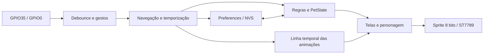

# TTGO Virtual Pet

**Versão do firmware: 2.0.0** · **Formato do progresso: 2**

Bichinho virtual para a **LILYGO TTGO T-Display clássica**, com ESP32, tela ST7789 e dois botões. A tela inicial mostra o nome no topo, o personagem centralizado com suas animações e a idade na parte inferior. Cuidados, indicadores, objetivos e personalização ficam em telas separadas.

O projeto funciona sem Wi-Fi, API, aplicativo externo ou servidor. O pet cresce conforme o tempo ligado e a qualidade dos cuidados, reage às necessidades e guarda o progresso na própria placa.

## Para quem vai usar o bichinho

Leia o [Manual ilustrado do usuário](docs/manual-do-usuario.md): primeiros passos, controles, cuidados, evolução, objetivos, personalização e dúvidas frequentes. Este README mantém a documentação de instalação e desenvolvimento.

## Índice

- [1. Recursos](#1-recursos)
- [2. Hardware e pinagem](#2-hardware-e-pinagem)
- [3. Ambiente e dependências](#3-ambiente-e-dependências)
- [4. Compilar, gravar e monitorar](#4-compilar-gravar-e-monitorar)
- [5. Primeiro uso](#5-primeiro-uso)
- [6. Telas e controles](#6-telas-e-controles)
- [7. Atributos e cuidados](#7-atributos-e-cuidados)
- [8. Tempo, sono e saúde](#8-tempo-sono-e-saúde)
- [9. Vínculo e expressões](#9-vínculo-e-expressões)
- [10. Animações](#10-animações)
- [11. Evolução](#11-evolução)
- [12. Objetivos e recompensas](#12-objetivos-e-recompensas)
- [13. Personalização e lojinha](#13-personalização-e-lojinha)
- [14. Economia de energia](#14-economia-de-energia)
- [15. Persistência e migração](#15-persistência-e-migração)
- [16. Arquitetura e arquivos](#16-arquitetura-e-arquivos)
- [17. Ajustar as regras](#17-ajustar-as-regras)
- [18. Testes e validação](#18-testes-e-validação)
- [19. Binário e pacote ZIP](#19-binário-e-pacote-zip)
- [20. Solução de problemas](#20-solução-de-problemas)
- [21. Limitações atuais](#21-limitações-atuais)
- [22. Histórico e referências](#22-histórico-e-referências)

## 1. Recursos

| Recurso | Comportamento |
| --- | --- |
| Tela inicial | Pet centralizado, nome no topo e idade abaixo; sem barras ou menu |
| Cuidados | Alimentar, brincar, banho, dormir/acordar e remédio |
| Indicadores | Comida, energia, alegria, higiene, saúde e vínculo |
| Expressões | Sono, doença, fome, sujeira, cansaço, tristeza, felicidade e carinho |
| Animações | Colher/mastigação, saltos/bola, banho/espuma, comprimido/frasco e efeitos de evolução |
| Crescimento | Bebê, jovem e adulto; idade e bons cuidados determinam as transições |
| Formas adultas | Carinhosa, tranquila, ativa ou clássica, com paleta automática própria |
| Objetivos | Quatro metas por dia de uso, com recompensa de moedas |
| Personalização | Oito nomes, seis opções de cor e três acessórios compráveis |
| Persistência | Progresso salvo na NVS; migração de versões 1.x |
| Economia | Redução de brilho e frequência de renderização por inatividade |

Não há morte permanente: mesmo com saúde zero, o pet pode ser recuperado com cuidados.

## 2. Hardware e pinagem

### Placa suportada

- TTGO T-Display **clássica**, baseada no ESP32 original.
- Tela ST7789 de 135 × 240 pixels em orientação nativa; firmware em **240 × 135**, paisagem.
- Dois botões físicos e cabo USB com comunicação de dados.
- Alimentação pela USB ou pelo circuito de bateria da placa, quando disponível.

**T-Display S3 não usa este perfil.** Confirme a identificação da PCB e a pinagem da sua unidade. A revisão de silício mostrada pelo ESP32 não identifica a revisão da placa.

### GPIOs usados

| Função | GPIO | Configuração |
| --- | --- | --- |
| TFT MOSI | 19 | SPI |
| TFT SCLK | 18 | SPI, 40 MHz |
| TFT CS | 5 | Seleção do display |
| TFT DC | 16 | Comando/dados |
| TFT reset | 23 | Reset do display |
| Backlight | 4 | Ativo HIGH; PWM de brilho |
| Botão de navegação | 35 | Ativo LOW, `INPUT`; pull-up externo da placa |
| Botão de ação | 0 | Ativo LOW, `INPUT_PULLUP`; também pino de boot |

GPIO35 não tem pull-up interno no ESP32. A leitura depende do resistor externo presente na T-Display. Não mantenha GPIO0 pressionado ao ligar/reiniciar a placa, pois isso pode selecionar o bootloader.

O driver TFT_eSPI é configurado pelo `platformio.ini`, com `ST7789_DRIVER`, dimensões nativas, `CGRAM_OFFSET`, fontes GLCD/2 e rotação 1. Não é necessário editar a instalação global da biblioteca.

O projeto não exige PSRAM. O perfil PlatformIO usa flash de **4 MB**; uma unidade com flash maior pode usar esse perfil dentro dos primeiros 4 MB. Sensores, touchscreen, som e leitura de bateria não estão implementados.

## 3. Ambiente e dependências

### Requisitos

1. VS Code com a extensão PlatformIO IDE, ou PlatformIO Core instalado.
2. Driver USB correspondente à interface da placa, caso o sistema não a reconheça.
3. Acesso à internet na primeira instalação dos pacotes; depois, ferramentas podem ser reutilizadas do cache.
4. Para testes de lógica: LLVM com WebAssembly + Node.js, ou um compilador C++ de host.

### Versões do projeto

| Componente | Versão |
| --- | --- |
| Ambiente PlatformIO | `ttgo-virtual-pet` |
| Placa PlatformIO | `lilygo-t-display` |
| Plataforma Espressif32 | `6.9.0` |
| Framework | Arduino; pacote usado no build resolve para Arduino ESP32 `2.0.17` |
| TFT_eSPI | `2.5.43` |
| Monitor serial | `115200` baud |

As versões da plataforma e biblioteca estão fixadas no [platformio.ini](platformio.ini). Não atualizar dependências sem recompilar e verificar a placa.

## 4. Compilar, gravar e monitorar

### Pelo VS Code

1. Abra **a pasta `ttgo-virtual-pet`**, que contém `platformio.ini`.
2. Use **PlatformIO: Build** para compilar.
3. Conecte a placa por USB e feche qualquer monitor serial aberto.
4. Use **PlatformIO: Upload** para gravar.
5. Abra **PlatformIO: Serial Monitor** em 115200 baud.

Abrir outro projeto TTGO e executar Upload grava o firmware desse outro projeto. Confira a pasta e o ambiente antes de gravar.

### Pelo terminal

Execute na raiz deste projeto:

```powershell
pio run
pio device list
pio run -t upload --upload-port COM3
pio device monitor --port COM3 --baud 115200
```

`COM3` é um exemplo; use a porta listada para sua placa. Linux/macOS usam nomes como `/dev/ttyUSB0` ou `/dev/cu.*`. Para fechar o monitor PlatformIO, use **Ctrl+C**.

### Se `pio` não estiver no PATH do Windows

```powershell
$petPio = Join-Path $env:USERPROFILE '.platformio\penv\Scripts\platformio.exe'
& $petPio run
& $petPio device list
& $petPio run -t upload --upload-port COM3
& $petPio device monitor --port COM3 --baud 115200
```

Prefira o cache global do PlatformIO no Windows. Caminhos muito longos para o compilador e framework podem causar falhas ao iniciar ferramentas internas do GCC.

### Log esperado

```text
TTGO Virtual Pet 2.0.0 / display=240x135 NVS=OK idade=0
```

A idade pode ser diferente de zero quando houver progresso salvo. O log confirma inicialização do software; cores, brilho, botões e aparência precisam da conferência física.

O Upload substitui a aplicação atualmente executada na placa. Use PlatformIO para gravar também bootloader e tabela de partições nas posições corretas. **Não execute erase-flash para uma atualização normal**, pois isso também apaga NVS.

## 5. Primeiro uso

Um pet novo começa com:

| Campo | Valor |
| --- | --- |
| Nome | Pip |
| Estágio | Bebê |
| Idade | 0 minutos |
| Moedas | 10 |
| Comida, energia, alegria e higiene | 80 |
| Saúde | 100 |
| Vínculo | 20 |
| Sono | Acordado |
| Cor | Automática pela evolução |
| Acessório | Nenhum |

Na tela inicial, toque **GPIO35** para abrir o menu. Selecione um cuidado com GPIO35 e confirme com GPIO0. Um cuidado aceito retorna à tela inicial e mostra sua animação.

Para acompanhar as necessidades, segure GPIO0 na tela inicial. Se já existir progresso válido na NVS, ele é carregado automaticamente, em vez de criar outro pet.

## 6. Telas e controles

### Gestos

O debounce é de **30 ms**. O toque é reconhecido ao soltar o botão. Pressionar por **700 ms** gera um gesto longo, sem executar um toque adicional ao soltar.

| Tela | GPIO35: toque | GPIO0: toque | Gesto longo |
| --- | --- | --- | --- |
| Inicial | Abrir cuidados | Carinho, se acordado e fora do cooldown | GPIO35 dorme/acorda; GPIO0 abre estatísticas |
| Cuidados | Próxima opção | Executar/abrir opção | Qualquer botão volta à inicial |
| Estatísticas | Sem ação | Sem ação | Qualquer botão volta à inicial |
| Objetivos | Sem ação | Resgatar recompensa | Qualquer botão volta à inicial |
| Personalizar | Próximo campo | Próximo valor do campo | Qualquer botão volta à inicial |
| Lojinha | Próximo item | Comprar ou equipar | Qualquer botão volta à inicial |
| Novo bichinho | Cancelar | Confirmar reinício | Qualquer botão cancela e volta à inicial |

Durante uma animação de cuidado, comandos de navegação/ação são **ignorados**, não enfileirados. Faça um novo toque quando ela terminar. A leitura dos botões, o tempo do pet e o salvamento continuam ativos.

### Menu de cuidados

1. Comida.
2. Brincar.
3. Banho.
4. Dormir ou acordar.
5. Remédio.
6. Estatísticas.
7. Objetivos.
8. Personalizar.
9. Lojinha.
10. Novo bichinho.

O menu mostra até quatro opções por página e mantém a seleção ao reabrir. Telas auxiliares retornam à inicial após **20 segundos sem interação**.

### Mensagens das telas auxiliares

- `Acorde primeiro`: ação recusada porque o pet dorme.
- `Preciso dormir`: energia insuficiente para brincar.
- `Moedas insuficientes`: saldo insuficiente para o cuidado ou compra.
- `Ja esta no maximo`: comida, higiene ou saúde já está em 100 para aquela ação.
- `Complete os objetivos`: há metas pendentes.
- `Recompensa ja recebida`: prêmio daquele dia de uso já resgatado.

A tela inicial mostra somente nome, animação do pet e idade. A idade é apresentada em horas e minutos de funcionamento acumulado, por exemplo `Idade: 2h 15m`. A expressão comunica a situação; as estatísticas mostram os atributos exatos.

## 7. Atributos e cuidados

Todos os atributos são limitados a **0–100**. Moedas são limitadas a **0–9.999**; aumentos acima desse limite saturam o saldo.

| Cuidado aceito | Efeito | Moedas | Vínculo | Condição |
| --- | --- | --- | --- | --- |
| Alimentar | Comida +20; higiene −3 | −1 | +2 | Acordado, comida <100 e saldo ≥1 |
| Brincar | Alegria +18; energia −10 | +2 | +3 | Acordado, energia ≥10 |
| Banho | Higiene +30; energia −2 | 0 | +2 | Acordado, higiene <100 |
| Remédio | Saúde +25 | −2 | +2 | Acordado, saúde <100 e saldo ≥2 |
| Dormir/acordar | Alterna estado de sono | 0 | Sem ganho imediato | Disponível mesmo com necessidades baixas |
| Carinho | Alegria +3 | 0 | +1 | Acordado; intervalo mínimo de 30 segundos na tela inicial |

Uma ação recusada não cobra moedas, não conta para objetivos e não mostra animação de sucesso. Dormir/acordar não cria vínculo instantâneo ao alternar repetidamente.

Se o saldo acabar, dormir permite recuperar energia para brincar e ganhar moedas. Não é necessário comprar remédio para toda recuperação: saúde também melhora com necessidades atendidas.

## 8. Tempo, sono e saúde

A idade conta **minutos acumulados com o firmware funcionando**. Não há RTC, NTP ou penalização pelo tempo desligado. Frações de minuto são guardadas no estado salvo.

### Alterações a cada minuto

| Atributo | Acordado | Dormindo |
| --- | --- | --- |
| Comida | −2 | −1 |
| Energia | −1 | +6 |
| Alegria | −1 | −1 |
| Higiene | −2 | −2 |

Dormir não pausa fome ou sujeira. Os minutos de sono são acumulados no histórico e nos objetivos.

### Saúde

Após atualizar as necessidades:

- Se comida <15, energia <10 **ou** higiene <15: saúde −3 naquele minuto.
- Caso contrário, com comida ≥40, energia ≥30 **e** higiene ≥40: saúde +1.
- Nas demais condições, a saúde fica igual.

O vínculo perde 1 em minutos de perigo que coincidam com múltiplos de cinco da idade. Dormindo, ganha 1 em múltiplos de cinco. Ambos os ajustes podem ocorrer no mesmo minuto.

Saúde zero altera a expressão, mas não bloqueia definitivamente cuidados. Comida, higiene, descanso e recuperação podem devolver o pet a uma condição saudável.

## 9. Vínculo e expressões

O humor é escolhido pela primeira condição satisfeita nesta ordem:

| Prioridade | Condição | Humor |
| --- | --- | --- |
| 1 | Dormindo | Sono |
| 2 | Saúde <25 | Doente |
| 3 | Comida <25 | Com fome |
| 4 | Higiene <25 | Sujo |
| 5 | Energia <25 | Cansado |
| 6 | Alegria <25 | Triste |
| 7 | Vínculo ≥65 | Carinhoso |
| 8 | Alegria ≥70 | Feliz |
| 9 | Nenhuma anterior | Tranquilo |

Assim, um pet com vínculo alto ainda demonstra fome ou doença quando essas necessidades aparecem. A tela usa piscadas, olhos cansados, boca triste, sinais de doença, tigela vazia, manchas/moscas e corações. Carinho aceito adiciona um efeito visual de três segundos.

## 10. Animações

| Situação | Elementos | Duração |
| --- | --- | --- |
| Comer | Colher chega à boca, mastigação, migalhas e tigela | 2,8 s |
| Brincar | Saltos, braços e bola quicando | 2,8 s |
| Banho | Banheira, espuma, gotas e bolhas | 3,36 s |
| Remédio | Frasco, comprimido na boca e brilho de recuperação | 2,8 s |
| Dormir | Olhos fechados e `zZ` | Enquanto dorme |
| Evoluir | Partículas de comemoração | 5 s |

A linha temporal dos cuidados muda de quadro a cada **140 ms**. A renderização normal ocorre a cada **100 ms**. Os atributos/custos são aplicados quando a ação é aceita; a animação apresenta o resultado visualmente.

Não são necessários arquivos de imagem ou sprites externos: o personagem e os efeitos são desenhados com primitivas TFT_eSPI em um sprite de 8 bits.

## 11. Evolução

### Estágios

| Transição | Requisitos simultâneos |
| --- | --- |
| Bebê → jovem | Idade ≥60 minutos e bons cuidados ≥20 minutos |
| Jovem → adulto | Idade ≥240 minutos e bons cuidados ≥90 minutos |

Um minuto entra no total de bons cuidados quando, após atualizar as necessidades e a saúde, comida/higiene são ≥40, energia ≥30 e saúde ≥50. Esses minutos são acumulados e não precisam ser consecutivos.

A idade sozinha não causa crescimento. O estágio não regride se os atributos caírem depois. Dormir pode contar como bom cuidado quando os demais requisitos estão atendidos.

### Forma adulta

A forma é definida **uma vez, ao virar adulto**, pela primeira condição satisfeita:

| Prioridade | Condição no histórico | Forma / cor automática |
| --- | --- | --- |
| 1 | Vínculo ≥65 | Carinhosa / rosa |
| 2 | Sono acumulado ≥60 minutos | Tranquila / violeta |
| 3 | Brincadeiras aceitas ≥15 | Ativa / laranja |
| 4 | Nenhuma anterior | Clássica / verde-água |

Bebês usam rosa e jovens azul na paleta automática. Uma cor escolhida em Personalizar substitui a cor automática, sem mudar o estágio ou histórico.

## 12. Objetivos e recompensas

Cada dia de uso tem quatro metas:

| Objetivo | Meta |
| --- | --- |
| Alimentar | 2 ações aceitas |
| Brincar | 2 ações aceitas |
| Banho | 1 ação aceita |
| Dormir | 5 minutos acumulados dormindo |

Com todas concluídas, abra Objetivos e toque GPIO0 para receber **8 moedas**. O resgate não é automático. A marca de prêmio recebido é persistida e impede recebê-lo novamente no mesmo ciclo.

**Dia de uso significa 1.440 minutos ligados acumulados**, não um dia do calendário. Ao entrar no próximo ciclo, contadores e marca de resgate são zerados. Dormir não precisa ser consecutivo; ações recusadas não contam. A tela apresenta “Dia ligado 1”, “Dia ligado 2” e assim por diante.

## 13. Personalização e lojinha

### Nomes

Pip, Nino, Luma, Bibi, Kiko, Tico, Lilo e Mimi. GPIO0 percorre a lista no campo Nome. Não há editor de texto livre.

### Cores

Automática pela evolução, rosa, azul, verde, amarelo e roxo. Alterar a cor não custa moedas.

### Acessórios

| Item | Primeira compra | Depois de adquirido |
| --- | --- | --- |
| Coleira | 6 moedas | Equipar sem custo |
| Laço | 8 moedas | Equipar sem custo |
| Chapéu | 10 moedas | Equipar sem custo |

A primeira compra também equipa o item. Personalizar percorre “Nenhum” e os acessórios já adquiridos; itens não comprados aparecem na lojinha. Compras e item equipado permanecem salvos. “Novo bichinho” reinicia também essas aquisições.

## 14. Economia de energia

| Parâmetro | Uso normal | Após 45 s sem interação |
| --- | --- | --- |
| PWM do backlight | 180/255 | 35/255 |
| Intervalo de renderização | 100 ms | 400 ms |
| Frequência aproximada | 10 quadros/s | 2,5 quadros/s |

PWM usa canal 0, frequência de **5 kHz** e resolução de 8 bits no GPIO4. Esses valores são duty cycle, não uma medição de luminosidade ou consumo.

Um botão restaura o brilho. Uma animação de cuidado em andamento impede a entrada em modo reduzido. A idade, os cuidados, a evolução e o salvamento continuam sendo processados. **Não há deep sleep** e o consumo elétrico ainda não foi medido na bancada.

## 15. Persistência e migração

### Onde fica o progresso

Preferences/NVS usa o namespace **`virtual-pet`** e a chave **`state`**, com um blob binário do `PetState`. O namespace é separado dos usados pelo Smart Hub e Control Center.

São armazenados:

- Versão do estado, idade e fração de minuto.
- Moedas, atributos, vínculo e estado de sono.
- Estágio e forma adulta.
- Minutos de bons cuidados/sono e brincadeiras acumuladas.
- Nome, cor, acessórios adquiridos e item equipado.
- Dia de uso, progresso dos objetivos e marca de recompensa resgatada.

### Quando grava

- **3 segundos após a última alteração interativa**, como cuidado, carinho, compra ou personalização.
- **A cada 5 minutos**, mesmo sem interação.
- Ao concluir a migração do formato antigo.

Alterações consecutivas adiam a gravação após ação. Desligar antes do próximo salvamento pode perder progresso recente. Animações e tela atual não são persistidas; o boot normal abre a tela inicial.

### Migração 1.x → 2.0

O formato antigo ocupa 20 bytes no alvo ESP32. O código identifica esse layout, valida seus valores e converte para o novo estado:

- Preserva idade, moedas, comida, energia, alegria, higiene, saúde e sono.
- Preserva o estágio correspondente à idade antiga: bebê, jovem ou adulto.
- Adultos migrados recebem forma clássica.
- Inicializa vínculo, nome, cor, acessórios e objetivos com os padrões da versão 2.
- Salva o blob no novo formato.

O firmware 1.x não entende o formato 2. Para manter o progresso, use atualização para a versão atual e evite downgrade/erase-flash. Não há exportação, backup ou restauração manual implementados.

Estados atuais são validados ao carregar. Estado de formato 2 inválido é substituído pelo estado inicial; legado inválido ou tamanho não reconhecido gera falha de inicialização da NVS. Consulte o serial se aparecer `NVS=FAIL`.

## 16. Arquitetura e arquivos

```text
ttgo-virtual-pet/
├── platformio.ini
├── README.md
├── include/
│   ├── pet/Pet.h
│   ├── input/Button.h
│   ├── storage/Save.h
│   └── display/
│       ├── Screen.h
│       └── ActionAnimation.h
├── src/
│   ├── main.cpp
│   ├── pet/Pet.cpp
│   ├── storage/Save.cpp
│   └── display/Screen.cpp
├── tests/pet_test.cpp
├── scripts/
│   ├── test.ps1
│   └── package.ps1
└── docs/
    ├── validation.md
    └── results.md
```

| Componente | Responsabilidade |
| --- | --- |
| `Pet` | Regras, estado, humores, crescimento, economia e objetivos |
| `Button` | Debounce, clique ao soltar e gesto longo |
| `ActionAnimation` | Duração/quadro/progresso de um cuidado, com tratamento do rollover de `millis()` |
| `Screen` | Desenho do pet, telas auxiliares, animações e backlight |
| `Save` | Validação, leitura, gravação e migração de NVS |
| `main.cpp` | Navegação, cooldown de carinho, relógio de execução, salvamento e inatividade |



O firmware usa o loop Arduino e temporização por `millis()`, com `delay(1)` para ceder execução ao sistema. Não há tarefa própria de rede ou espera pela conexão. Renderização SPI e gravação NVS são operações síncronas; o projeto não oferece garantia de tempo real.

## 17. Ajustar as regras

| Alteração desejada | Arquivo / local |
| --- | --- |
| Valores iniciais, nomes de campos e formato do estado | `include/pet/Pet.h` |
| Custos/efeitos dos cuidados | `Pet::act()` em `src/pet/Pet.cpp` |
| Desgaste, recuperação e requisitos de evolução | `Pet::minute()` |
| Prioridade das expressões | `Pet::mood()` |
| Metas/recompensa e preços | `objectivesComplete()`, `claimReward()` e `buy()` |
| Nomes, cores, desenhos e telas | `src/display/Screen.cpp` |
| Duração das animações | `include/display/ActionAnimation.h` |
| Intervalo de salvamento, carinho e inatividade | `src/main.cpp` |
| Pinos/driver/fontes e dependências | `platformio.ini` |

Ao mudar a estrutura `PetState`, defina uma nova versão e uma migração explícita: o progresso é um blob binário, não um JSON independente do layout C++. Recompile, execute os testes e valide a placa após alterar regras ou desenho.

## 18. Testes e validação

### Testes C++ em WebAssembly

Requer LLVM/Clang com backend WebAssembly e `wasm-ld`, mais Node.js:

```powershell
./scripts/test.ps1 -Clang 'C:/caminho/clang.exe' -Node 'C:/caminho/node.exe'
```

Se a política de execução do PowerShell impedir o script, execute somente essa chamada em um processo com política temporária:

```powershell
powershell -NoProfile -ExecutionPolicy Bypass -File ./scripts/test.ps1 -Clang 'C:/caminho/clang.exe' -Node 'C:/caminho/node.exe'
```

O script compila o **motor C++ real** e o controlador de animação para WebAssembly e executa no Node. As rotinas `memcpy`/`memset` presentes no teste são suporte do ambiente freestanding, restrito a WebAssembly.

### Alternativa com compilador de host

```sh
g++ -std=c++11 -Iinclude tests/pet_test.cpp src/pet/Pet.cpp -o pet_test
./pet_test
```

No Windows, o executável pode ser `pet_test.exe`; execute `./pet_test.exe`.

### Cobertura

- Custos, efeitos, limites e recusa de cuidados.
- Sono, recuperação e moedas.
- Prioridade dos humores.
- Evolução condicionada à qualidade dos cuidados e variantes adultas.
- Objetivos, resgate único e mudança de dia de uso.
- Compras sem cobrança duplicada e acessórios disponíveis.
- Personalização e rejeição de estados inválidos.
- Migração do formato antigo com preservação do progresso básico.
- Início, fim, reentrada e rollover do temporizador de animações.

Testes de lógica não simulam tela, PWM, GPIO ou flash física. Siga o [checklist de bancada](docs/validation.md) para esses itens.

### Resultados registrados da versão 2.0

| Medida de build | Resultado |
| --- | --- |
| RAM estática | 22.428 bytes, 6,8% do limite informado pelo PlatformIO |
| Uso da partição da aplicação | 328.993 bytes, 25,1% |
| Sprite alocado em heap | 32.400 bytes adicionais |
| Build PlatformIO | Aprovado |
| Testes do motor/animação | Aprovados |
| Aparência final, PWM e persistência física | Conferir na placa após upload |

Esses números pertencem ao build registrado, não são uma garantia de heap livre durante execução nem o tamanho exato do arquivo `.bin`. O [histórico de resultados](docs/results.md) contém os registros por versão.

## 19. Binário e pacote ZIP

Depois do build:

```text
.pio/build/ttgo-virtual-pet/firmware.bin
```

Esse é o binário da aplicação. Para a primeira gravação ou atualização por USB, prefira PlatformIO Upload, que usa também bootloader e tabela de partições corretos.

Gerar pacote distribuível:

```powershell
./scripts/package.ps1
```

Saída:

```text
dist/ttgo-virtual-pet-2.0.0.zip
```

O script inclui fontes, headers, testes, scripts, documentação e `platformio.ini`; inclui `firmware.bin` quando ele já existe. Caches `.pio`, configurações `.vscode` e diretório `dist` não entram no pacote. O Git ignora os artefatos gerados.

O nome do ZIP é definido no script, não deduzido do código. Ao publicar outra versão, atualize mensagem de boot, nome do pacote e documentação em conjunto.

## 20. Solução de problemas

| Sintoma | Verificação / ação |
| --- | --- |
| Tela escura logo após inatividade | Toque um botão: após 45 segundos o brilho é reduzido |
| Tela sempre apagada | Confira alimentação, placa clássica, pinagem, backlight GPIO4 e resultado `display=` no serial |
| Imagem cortada ou orientação errada | Confira ST7789, `CGRAM_OFFSET`, dimensões nativas e `setRotation(1)` |
| Botões não respondem | Confira GPIO35/GPIO0 e pull-up externo do GPIO35; aguarde acabar a animação de cuidado |
| Botão longo não executa toque | Comportamento previsto: o gesto longo suprime o clique ao soltar |
| Placa fica no bootloader | Solte GPIO0 e reinicie; não manter esse botão pressionado ao ligar |
| Upload não abre COM3 | Confirme a porta com `pio device list`; feche monitores/terminais que a utilizem |
| Serial mostra outro firmware | Abra a pasta deste projeto e faça Upload; conferir `TTGO Virtual Pet 2.0.0` no boot |
| Não consegue alimentar | Pet precisa estar acordado, ter comida <100 e pelo menos uma moeda |
| Não consegue brincar | Acorde e recupere energia até pelo menos 10 |
| Banho/remédio recusado | O atributo correspondente já pode estar em 100; remédio também requer duas moedas |
| Pet não evolui pela idade | Verifique minutos de bons cuidados e os requisitos da seção Evolução |
| Objetivos não resetam à meia-noite | O ciclo é de 24 horas ligadas acumuladas, sem calendário/RTC |
| Acessório não aparece em Personalizar | Compre na lojinha; essa tela percorre somente itens adquiridos |
| Progresso recente não voltou após desligar | Aguardar salvamento após a última alteração; checkpoint automático é de cinco minutos |
| `NVS=FAIL` ou `Pet: falha NVS` | Confira logs, tamanho/formato do estado e gravação da flash; não apagar flash como primeiro passo |
| `Falha de memoria da tela` | A alocação do sprite falhou; verificar heap e mudanças que aumentaram uso de RAM |
| Aviso `TOUCH_CS pin not defined` | Esperado neste perfil sem touchscreen |
| GCC falha com `CreateProcess` | Usar cache global/caminho curto de ferramentas; conferir instalação PlatformIO |

## 21. Limitações atuais

- Tempo e objetivos são baseados apenas no período com a placa ligada.
- Nomes e cores vêm de listas; não há teclado/editor livre.
- Não há som, sensor de toque, leitura de bateria ou controle por celular.
- Não há Wi-Fi, MQTT, APIs, OTA ou backend neste projeto.
- Modo econômico reduz brilho/renderização; não suspende o ESP32 em deep sleep.
- Formato NVS é binário e ligado ao layout C++/versão do alvo; sem exportação automática.
- A evolução adulta usa uma forma/paleta escolhida no momento da transição.
- Qualidade visual e consumo elétrico dependem da validação física na unidade usada.

## 22. Histórico e referências

| Versão | Alterações |
| --- | --- |
| 1.0.0 | Pet inicial, atributos, moedas, cuidados, idade e NVS |
| 1.1.0 | Animações específicas de comer, brincar, banho e remédio |
| 2.0.0 | Tela inicial limpa com nome e idade, vínculo/humores, evolução por cuidados, objetivos, personalização, acessórios, brilho por inatividade e migração do estado |

Referências técnicas:

- [LILYGO: T-Display clássica, exemplos e esquemas](https://github.com/Xinyuan-LilyGO/TTGO-T-Display).
- [TFT_eSPI: configuração Setup25 da TTGO T-Display](https://github.com/Bodmer/TFT_eSPI/blob/master/User_Setups/Setup25_TTGO_T_Display.h).
- [PlatformIO: plataforma Espressif32](https://docs.platformio.org/en/latest/platforms/espressif32.html).

A implementação deste repositório é a referência para as regras do jogo. As instruções e valores acima correspondem ao firmware 2.0.0.

### Ilustrações do manual

As imagens em `docs/imagens/` são reconstruções das chamadas do `Screen.cpp` com rasterização e fontes de host. Os arquivos de geração e instruções ficam em [scripts/manual-images](scripts/manual-images/README.md). Não são capturas físicas da placa. O mock de desenho é exclusivo da documentação e não participa da compilação do firmware.
