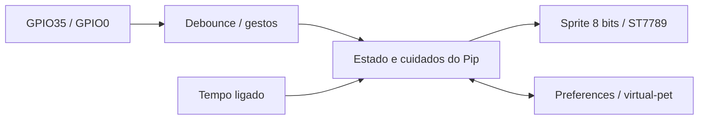

# TTGO Virtual Pet

Bichinho virtual chamado **Pip**, em um projeto separado para a TTGO T-Display clássica (ESP32 + ST7789). Personagem desenhado com formas e pixels, animação de respiração, piscadas, sono, expressões e evolução visual. Não usar este perfil na T-Display S3.

## Cuidar do Pip

- Comida, energia, alegria, higiene e saúde, de 0 a 100. Barras mais cheias significam melhor condição.
- Alimentar custa 1 moeda; brincar rende 2 moedas e consome energia; banho é gratuito; remédio custa 2 moedas.
- Dormir recupera energia a cada minuto. Enquanto dorme, acorde antes das outras ações.
- Com condições boas, a saúde se recupera gradualmente. Com necessidades baixas, cai. Mesmo debilitado, o Pip permite cuidados e recuperação.
- Bebê durante a primeira hora ligada, jovem a partir de 60 minutos e adulto a partir de 240 minutos.
- As necessidades mudam a cada minuto de funcionamento. O tempo com a placa desligada não é contabilizado: este projeto não usa Wi-Fi nem relógio externo.

## Botões

| Gesto | Ação |
| --- | --- |
| Toque GPIO35 | Selecionar próximo cuidado |
| Toque GPIO0 | Executar cuidado selecionado |
| Segurar GPIO0 por 700 ms | Alternar tela principal e estatísticas |
| Segurar GPIO35 por 700 ms | Dormir/acordar rapidamente |

“Novo bichinho” abre uma confirmação: GPIO35 cancela; GPIO0 confirma. GPIO0 é o pino de boot: não manter pressionado ao reiniciar a placa.

## Instalar

Abra esta pasta no VS Code + PlatformIO. Execute `pio run`, depois `pio run -t upload --upload-port COM3` (ajuste a porta). Feche o monitor antes do upload. Abra `pio device monitor --port COM3 --baud 115200` para diagnóstico.

Gravar o Virtual Pet substitui a aplicação atual da placa. O projeto usa NVS `virtual-pet`, separado do Smart Hub e do Control Center. O progresso é salvo 3 segundos após o último cuidado e a cada 5 minutos; desligar antes pode perder o progresso ainda não salvo. Não fazer erase-flash se quiser preservar as configurações dos outros projetos.

Pinagem: ST7789 MOSI19, SCLK18, CS5, DC16, reset23, backlight4; botões35/0 ativos LOW. GPIO35 depende do pull-up externo da T-Display. Orientação 240 × 135, sprite de 8 bits (32.400 bytes), sem PSRAM. Perfil de flash conservador de 4 MB.

## Estrutura e validação

`src/pet`: regras e evolução. `src/display`: telas e desenho do personagem. `src/storage`: persistência. `include/input`: debounce e gestos. `src/main.cpp`: navegação e temporização sem espera por input.

Testes de regras, ações, limites, sono, moedas, evolução, recuperação e validação do estado: `scripts/test.ps1 -Clang CAMINHO/clang.exe -Node CAMINHO/node.exe`, com LLVM/WebAssembly e Node. Alternativa: `g++ -std=c++11 -Iinclude tests/pet_test.cpp src/pet/Pet.cpp -o pet_test` e executar.

Checklist de bancada em `docs/validation.md`. A compilação não valida display, botões ou persistência física. Binário em `.pio/build/ttgo-virtual-pet/firmware.bin`. ZIP gerado por `scripts/package.ps1`, em `dist/ttgo-virtual-pet-1.0.0.zip`.

Dependências fixadas: Espressif32 6.9.0, Arduino ESP32 2.0.17 e TFT_eSPI 2.5.43. Usar cache global do PlatformIO no Windows para manter curtos os caminhos de ferramentas.
