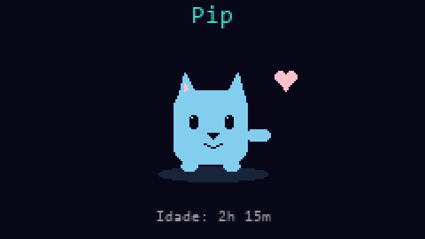
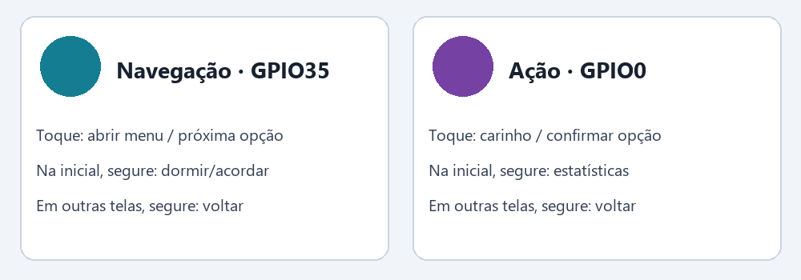
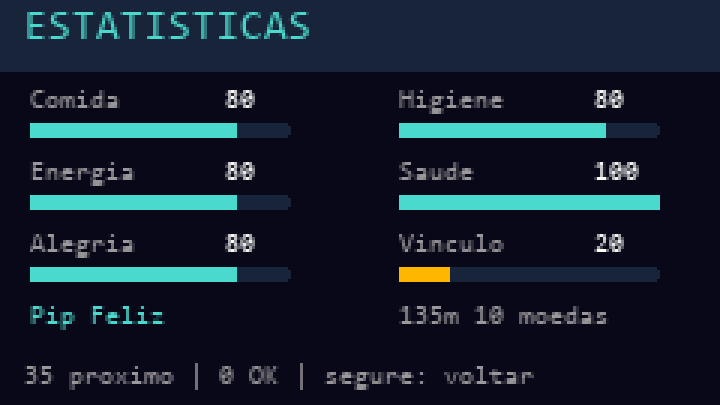
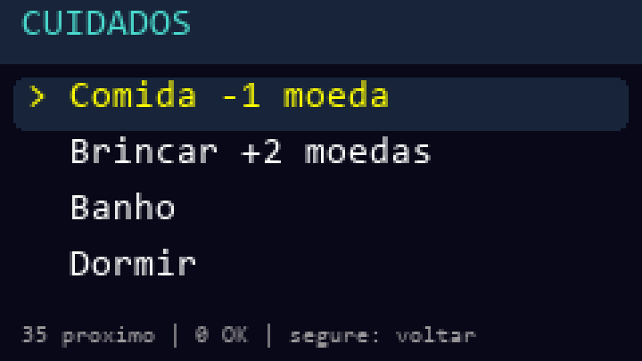
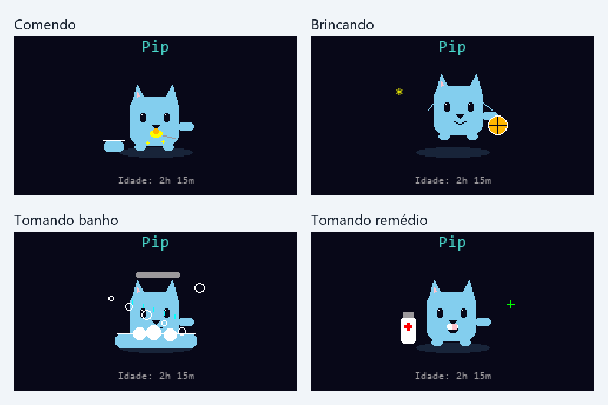
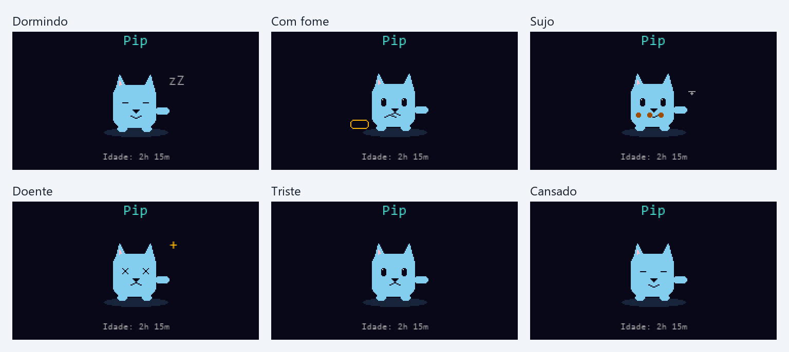
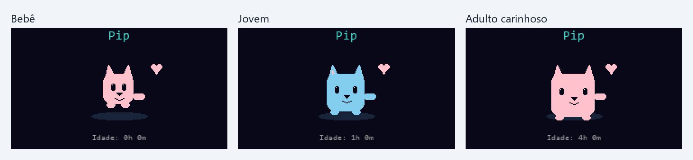
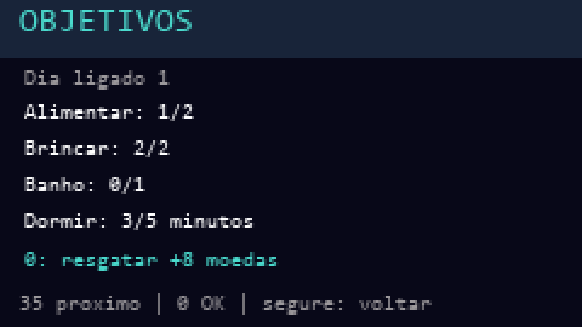
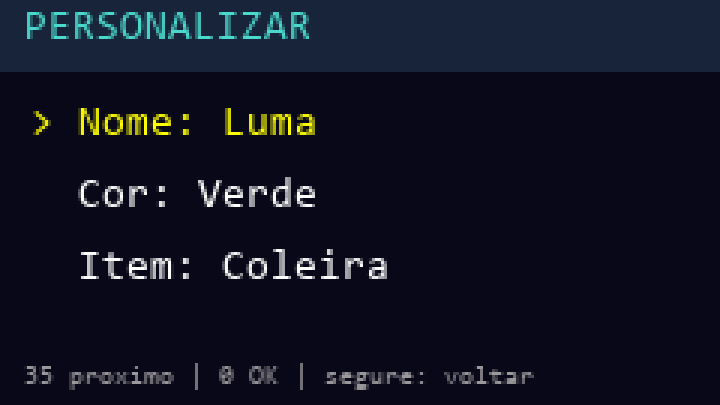
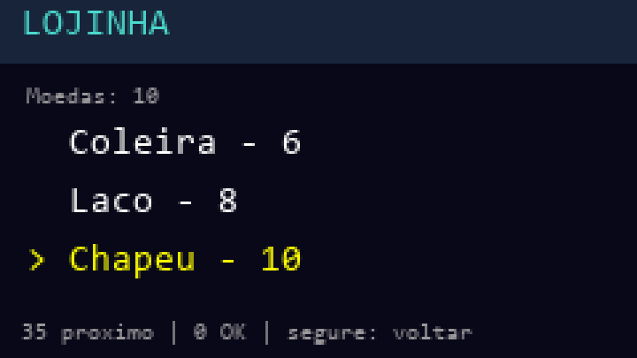

# Manual do usuário — TTGO Virtual Pet

**Para a versão 2.0.0.** Este manual considera que o bichinho já está instalado na placa. Para instalar ou atualizar o firmware, consulte o [README do projeto](../README.md#4-compilar-gravar-e-monitorar).

Seu bichinho precisa de comida, descanso, diversão e limpeza. Você cuida dele com dois botões; ele responde com expressões e animações. O progresso é salvo automaticamente e não é necessário conectar à internet.

> As imagens deste manual são ilustrações reconstruídas a partir do código de desenho do firmware 2.0.0. Não são fotografias da placa; fontes e pequenos detalhes de rasterização podem variar na tela física.

## Comece por aqui

*Exemplo da tela principal: nome no topo e idade abaixo do bichinho.*

1. Ligue a placa sem manter nenhum botão pressionado.
2. Na tela principal, observe o **nome**, o **bichinho animado** e a **idade**.
3. Segure o botão de ação por aproximadamente **um segundo** para abrir as estatísticas.
4. Veja qual necessidade está mais baixa.
5. Segure qualquer botão para voltar à tela principal.
6. Toque no botão de navegação para abrir os cuidados.
7. Escolha o cuidado necessário e confirme com o botão de ação.
8. Aguarde a animação terminar antes de dar outro comando.

Um bichinho novo se chama **Pip**, começa com **10 moedas** e tem necessidades em boa condição. Se você já tiver brincado antes, o progresso salvo será retomado.

## Conheça os dois botões

*Este desenho identifica as funções, não a posição física dos botões na placa.*

Neste manual:

- **Navegação — GPIO35:** abre o menu e percorre as opções.
- **Ação — GPIO0:** confirma opções e executa cuidados.

A posição física pode variar com a orientação da placa. Para identificar: na tela principal, um toque no botão de navegação abre o menu; um toque no botão de ação faz carinho quando o pet está acordado e disponível.

**Toque:** pressione e solte rapidamente. **Segure:** mantenha pressionado por aproximadamente um segundo. Não mantenha o botão de ação pressionado enquanto liga ou reinicia a placa.

### Guia rápido

| Onde você está | Navegação: toque | Ação: toque | Segurar |
| --- | --- | --- | --- |
| Tela principal | Abrir os cuidados | Fazer carinho | Navegação: dormir/acordar; ação: estatísticas |
| Menu de cuidados | Próxima opção | Escolher opção | Qualquer botão: voltar à tela principal |
| Estatísticas | — | — | Qualquer botão: voltar |
| Objetivos | — | Resgatar prêmio | Qualquer botão: voltar |
| Personalizar | Próximo campo | Próximo valor | Qualquer botão: voltar |
| Lojinha | Próximo item | Comprar/equipar | Qualquer botão: voltar |
| Confirmar novo bichinho | Cancelar | Confirmar reinício | Qualquer botão: cancelar e voltar |

Os menus voltam à tela principal após 20 segundos sem interação. Durante uma animação de cuidado, os comandos são ignorados: toque novamente depois que ela terminar.

## Entenda as estatísticas

Todos os indicadores vão de **0 a 100**. Barras mais cheias significam melhor condição.

| Indicador | Significado | Como melhorar |
| --- | --- | --- |
| Comida | Quanto o pet está alimentado | Dar comida |
| Energia | Disposição para brincar | Dormir |
| Alegria | Quanto está contente | Brincar ou fazer carinho |
| Higiene | Quanto está limpo | Dar banho |
| Saúde | Condição geral | Atender necessidades e, quando necessário, dar remédio |
| Vínculo | Proximidade com você | Cuidar, brincar e fazer carinho |

A expressão mostra a necessidade mais urgente. Abra as estatísticas para conferir os números: um pet pode ter mais de uma necessidade baixa ao mesmo tempo.

## Como realizar um cuidado

*A seta destaca a opção selecionada; toque Navegação para mudar e Ação para confirmar.*

1. Na tela principal, toque **Navegação**.
2. Toque **Navegação** até a seta apontar para a opção desejada.
3. Toque **Ação** para confirmar.
4. Se o cuidado for aceito, o pet volta à tela principal e mostra sua animação.
5. Depois, confira as estatísticas se quiser acompanhar o resultado.

*Quadros de exemplo dos quatro cuidados animados.*

### Dar comida

Escolha **Comida**. Custa **1 moeda** e aumenta a comida em até **20 pontos**. O pet precisa estar acordado e não pode estar com comida em 100.

Ele mostra uma colher chegando à boca e mastiga. Comer diminui um pouco a higiene; lembre-se do banho quando ela baixar.

### Brincar

Escolha **Brincar**. A alegria aumenta em até **18 pontos**, ele gasta **10 de energia** e você ganha **2 moedas**.

O pet precisa estar acordado e ter pelo menos 10 de energia. Na animação, ele salta e brinca com uma bola.

### Dar banho

Escolha **Banho**. É gratuito, aumenta a higiene em até **30 pontos** e consome **2 de energia**. Se a higiene já estiver em 100, o banho será recusado.

Ele aparece na banheira com gotas, bolhas e espuma.

### Dormir e acordar

No menu, escolha **Dormir** ou **Acordar**. Você também pode segurar **Navegação** na tela principal para alternar entre os dois estados.

A energia aumenta **6 pontos por minuto dormindo**. Comida e higiene continuam diminuindo, por isso não deixe de conferir essas necessidades. Enquanto dorme, ele não aceita comida, brincadeira, banho, remédio ou carinho: acorde primeiro.

### Dar remédio

Escolha **Remédio**. Custa **2 moedas** e recupera até **25 pontos de saúde**. O pet precisa estar acordado e ter saúde abaixo de 100.

A animação mostra um frasco e um comprimido. Remédio melhora a saúde, mas não resolve fome, sujeira ou falta de energia: cuide dessas necessidades também.

### Fazer carinho

Na tela principal, toque **Ação**. O carinho aumenta um pouco a alegria e o vínculo e mostra corações quando aceito.

O efeito pode ser usado **uma vez a cada 30 segundos**, com o pet acordado. Tocar repetidamente nesse intervalo não traz ganhos adicionais.

## Uma rotina simples de cuidados

Quando abrir o bichinho, confira as estatísticas e siga esta ordem conforme a necessidade:

1. **Comida baixa:** alimente, se houver moedas.
2. **Higiene baixa:** dê banho.
3. **Energia baixa:** deixe dormir e confira novamente após alguns minutos.
4. **Alegria baixa:** faça carinho ou brinque quando houver energia.
5. **Saúde baixa:** mantenha as necessidades atendidas; use remédio se tiver moedas.

Procure manter comida e higiene em **40 ou mais**, energia em **30 ou mais** e saúde em **50 ou mais**. Isso ajuda a recuperação e conta como bons cuidados para a evolução.

A saúde se recupera gradualmente quando comida, energia e higiene estão bem. Se as necessidades ficarem muito baixas, a saúde cai. Mesmo com saúde zero, o bichinho pode ser recuperado.

## O que as expressões querem dizer

| O que você percebe | O que fazer |
| --- | --- |
| Olhos fechados e `zZ` | Está dormindo; acorde para realizar cuidados |
| Aparência doente | Abra as estatísticas, trate necessidades baixas e considere remédio |
| Tigela vazia e expressão de fome | Dê comida |
| Manchas e moscas | Dê banho |
| Olhos cansados | Deixe dormir |
| Boca triste | Confira a alegria; carinho ou brincadeira podem ajudar |
| Corações e expressão contente | Está feliz ou tem um vínculo forte com você |
| Partículas de comemoração | Ele evoluiu para outro estágio |

Sono e necessidades urgentes têm prioridade sobre a expressão de felicidade. Corações não substituem a conferência das estatísticas.

## Como o bichinho cresce

*Exemplos com os requisitos de bons cuidados atendidos; idade sozinha não garante evolução.*

Existem três estágios: **bebê**, **jovem** e **adulto**.

- Para virar jovem: pelo menos **60 minutos ligado** e **20 minutos de bons cuidados**.
- Para virar adulto: pelo menos **240 minutos ligado** e **90 minutos de bons cuidados**.

Bons cuidados são minutos com comida/higiene ≥40, energia ≥30 e saúde ≥50. Esses minutos se acumulam; não precisam ser seguidos. Só deixar a placa ligada não garante crescimento.

Ao virar adulto, a cor automática reflete o histórico: vínculo alto favorece a forma carinhosa; bastante descanso favorece a tranquila; muitas brincadeiras favorecem a ativa. Há também a forma clássica. A forma é escolhida ao evoluir e não muda depois. Escolher uma cor personalizada muda a aparência sem apagar esse histórico.

A idade mostrada abaixo do pet, como `Idade: 2h 15m`, é o tempo de funcionamento acumulado. O período com a placa desligada não aumenta a idade nem desgasta as necessidades.

## Objetivos: ganhe mais moedas

*Exemplo de metas em andamento. O resgate só é aceito quando todas estiverem completas.*

Abra **Objetivos** pelo menu. Complete:

- Alimentar **2 vezes**.
- Brincar **2 vezes**.
- Dar **1 banho**.
- Dormir por **5 minutos acumulados**.

Depois, na tela Objetivos, toque **Ação** para resgatar **8 moedas**. O prêmio não é automático e só pode ser recebido uma vez por ciclo. Ações recusadas não contam.

“Dia ligado” significa **24 horas acumuladas com a placa funcionando**. Não é o dia do calendário e não muda à meia-noite. No próximo ciclo, as metas são renovadas. Progresso e prêmio resgatado são salvos.

## Trocar nome, cor e acessórios

### Nome e cor

1. Abra **Personalizar** pelo menu.
2. Use **Navegação** para escolher Nome, Cor ou Item.
3. Toque **Ação** para percorrer as opções desse campo.
4. Segure qualquer botão para voltar à tela principal.

Nomes disponíveis: **Pip, Nino, Luma, Bibi, Kiko, Tico, Lilo e Mimi**.

Cores: **automática pela evolução, rosa, azul, verde, amarelo e roxo**. Trocar nome ou cor é gratuito. O nome escolhido aparece no topo da tela principal.

### Comprar e equipar

Abra **Lojinha**, escolha o item com Navegação e confirme com Ação:

| Item | Preço da primeira compra |
| --- | --- |
| Coleira | 6 moedas |
| Laço | 8 moedas |
| Chapéu | 10 moedas |

A compra já equipa o item. Equipar um item comprado não cobra novamente. Na tela Personalizar, o campo Item permite alternar entre **Nenhum** e os acessórios que você já possui.

Se faltar dinheiro, brinque para ganhar moedas ou complete os objetivos. Se estiver sem energia, dormir é gratuito.

## Desligar, retomar e brilho reduzido

O progresso é salvo automaticamente **3 segundos após a última alteração** e também **a cada 5 minutos**.

Depois de terminar os cuidados ou a personalização, aguarde alguns segundos antes de desligar. Para ter uma margem prática, espere **5 segundos após a última ação**. Alterações contínuas adiam o salvamento após ação; idade e desgaste recentes também podem depender do checkpoint de cinco minutos.

Ao ligar novamente, o progresso salvo retorna. Não é necessário deixar o pet conectado à internet. Compras, nome, cor, atributos e objetivos fazem parte desse progresso.

Após **45 segundos sem interação**, a tela fica mais escura e a animação fica mais lenta para economizar energia. Isso não significa que a placa travou. Toque um botão para restaurar o brilho. O bichinho continua envelhecendo e suas necessidades continuam mudando enquanto a placa estiver ligada.

## Começar outro bichinho

1. Abra o menu e escolha **Novo bichinho**.
2. Na confirmação, toque **Navegação** para cancelar ou **Ação** para confirmar.
3. Depois de confirmar, você volta à tela principal com um novo pet bebê.

Essa opção reinicia **todo o progresso do pet**: idade, moedas, atributos, vínculo, nome/cor, acessórios e objetivos. Se você só quiser outro nome ou visual, use Personalizar.

## Quando algo não acontecer como esperado

| Situação | Como proceder |
| --- | --- |
| Toquei e nada aconteceu durante o cuidado | Espere a animação terminar e toque novamente; não há fila de comandos |
| Não consigo alimentar | Acorde o pet, confira se a comida está abaixo de 100 e se há pelo menos uma moeda |
| Não consigo brincar | Acorde e deixe dormir até recuperar pelo menos 10 de energia |
| Não consigo dar banho | Acorde e confira se a higiene já está em 100 |
| Não consigo dar remédio | Acorde, confira a saúde e o saldo de duas moedas |
| O carinho não aparece novamente | Aguarde 30 segundos e confira se está acordado |
| Acabaram as moedas | Deixe dormir; depois brinque para ganhar moedas. Banho e descanso são gratuitos |
| O pet não cresce apesar da idade | Confira se também acumulou minutos com bons cuidados |
| Completei as metas e não ganhei moedas | Abra Objetivos e toque Ação para resgatar |
| O acessório comprado não aparece na lista | Na tela Personalizar, selecione Item e toque Ação para percorrer os itens adquiridos |
| A tela ficou escura | Toque um botão; pode estar no modo de brilho reduzido |
| Um menu fechou sozinho | Após 20 segundos sem interação ele volta à tela principal |
| Uma mudança recente não voltou após reiniciar | Ela pode não ter sido salva antes de desligar; aguarde o salvamento antes de repetir o teste |
| Apareceu falha de salvamento ou a tela continua apagada | Peça ajuda a quem instalou o firmware; informe a mensagem exibida. O README contém o diagnóstico técnico |

## Exemplo de uma sessão

1. Ligue e abra as estatísticas segurando Ação.
2. Volte, dê comida se necessário e espere a animação.
3. Brinque quando a energia permitir para ganhar moedas.
4. Dê banho se a higiene estiver baixa.
5. Faça carinho na tela principal.
6. Deixe dormir quando a energia diminuir; antes de outros cuidados, acorde.
7. Confira Objetivos e resgate quando concluir todas as metas.
8. Aguarde alguns segundos após a última mudança antes de desligar.

Você não precisa executar todos os cuidados em toda sessão. Use as expressões e estatísticas para decidir o que o pet precisa naquele momento.
